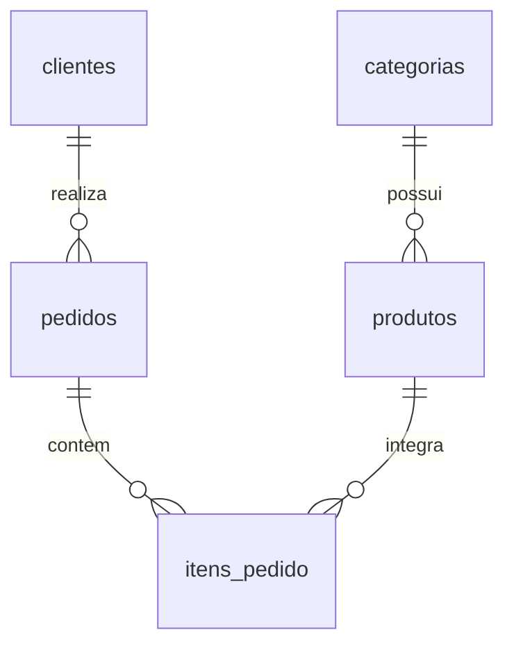

# TechStore | Consultas SQL, Stored Procedures e Views

Atividade introdutória de Banco de Dados do SENAI, desenvolvida no contexto de uma loja de tecnologia. O banco `loja_tech` relaciona categorias, produtos, clientes, pedidos e itens de pedidos.

## Objetivos

- Reproduzir o esquema e a carga inicial fornecidos pelo professor.
- Resolver 10 consultas e 5 Stored Procedures da lista obrigatória.
- Aplicar Views a 5 situações de consulta reutilizável da TechStore.
- Executar e conferir os exercícios no MySQL Workbench.

## Tecnologias e situação da execução

SQL executado no MySQL 8.4.13 pelo MySQL Workbench 8.0 CE. Documentação escrita em Markdown para GitHub.

**Validação concluída em 24/11/2026:** banco criado, carga inicial conferida, 10 consultas, 5 procedures e 5 Views executadas individualmente no Workbench.

## Estrutura do banco

| Tabela | Chave primária | Finalidade | Linhas iniciais |
|---|---|---|---:|
| categorias | id_categoria | Agrupar produtos | 5 |
| produtos | id_produto | Preço e estoque do catálogo | 11 |
| clientes | id_cliente | Cadastro dos clientes | 5 |
| pedidos | id_pedido | Cabeçalho e total dos pedidos | 5 |
| itens_pedido | id_item | Quantidade e preço por item | 7 |
| log_operacoes | id_log | Registro de operações nos exemplos da aula | 0 |



As chaves estrangeiras ligam `produtos.id_categoria`, `pedidos.id_cliente`, `itens_pedido.id_pedido` e `itens_pedido.id_produto` às respectivas chaves primárias. `log_operacoes` não possui chave estrangeira. O esquema permite um pedido sem itens, embora os pedidos da carga tenham itens.

Foram preservados os tipos, restrições e dados do esquema: e-mail e CPF únicos, valores padrão, status em `ENUM`, datas automáticas e `subtotal` gerado por `quantidade * preco_unitario`. A tabela de log foi preservada porque faz parte do banco fornecido; os cinco exercícios não solicitam gravar nela.

## Organização

```text
repositorio/
├── README.md
└── sql/
    ├── 01-banco-de-dados.sql
    ├── 02-consultas.sql
    ├── 03-stored-procedures.sql
    └── 04-views.sql
```

O guia de estudo `guia-de-apresentacao.md` fica em TechStore, fora do repositório.

## Como executar

1. Abra o Workbench e conecte-se ao servidor local. Informe a senha diretamente no programa.
2. Execute `SHOW DATABASES LIKE 'loja_tech';`. Se existir, interrompa a criação e revise o conteúdo antes de reutilizá-lo. Não exclua o banco.
3. Se o banco não existir, abra e execute [01-banco-de-dados.sql](sql/01-banco-de-dados.sql) uma única vez. O script não contém `DROP DATABASE`.
4. Abra [02-consultas.sql](sql/02-consultas.sql). Execute `USE loja_tech;` e depois selecione e execute cada exercício individualmente com Ctrl+Shift+Enter.
5. Abra [03-stored-procedures.sql](sql/03-stored-procedures.sql). Execute cada bloco completo, do `DROP PROCEDURE` até `DELIMITER ;`, e depois sua demonstração. Para o exercício 4, consulte o telefone antes e depois do CALL. Para o 5, execute CALL e SELECT na mesma conexão.
6. Abra [04-views.sql](sql/04-views.sql). Execute cada `CREATE VIEW` e sua consulta de demonstração individualmente.

Execute as consultas antes das demonstrações de alteração. A procedure 3 acrescenta uma categoria a cada CALL; não repita a chamada sem intenção. A procedure 4 substitui o telefone do cliente 1. O script de procedures recria as cinco rotinas com os nomes exigidos: revise antes de executá-lo em um banco já utilizado. As Views usam CREATE VIEW e não sobrescrevem objetos existentes.

## As 10 consultas

Resultados observados no Workbench com a carga inicial:

| Nº | Consulta | Resultado observado |
|---:|---|---|
| 1 | Listagem básica de clientes | 5 clientes; somente nome e e-mail. |
| 2 | Produtos com preço abaixo de R$ 500 | 5 produtos, de R$ 219,90 a R$ 499,90. |
| 3 | Pedidos pendentes | Pedido 3, com todas as colunas. |
| 4 | Catálogo do maior para o menor preço | 11 produtos; iPhone 15 primeiro e SSD Kingston 480GB por último. |
| 5 | Produtos com Monitor no nome | Produtos 8 e 9. |
| 6 | Periféricos com mais de 40 unidades | Teclado Mecânico Redragon: 60; Mouse Logitech G502: 45. |
| 7 | Quantidade total de clientes | total_clientes = 5. |
| 8 | Soma de todos os pedidos | faturamento_bruto = 15897.40. |
| 9 | Produtos e respectivas categorias | 11 pares de produto e categoria. |
| 10 | Pedidos de Ana Silva | Pedidos 1 (entregue, 3749.80) e 4 (processando, 6499.00). |

## As 5 Stored Procedures

### 1. `listar_categorias_ativas`

Lista as 5 categorias iniciais ativas por nome. Execute antes de inserir a sexta categoria.

```sql
CALL listar_categorias_ativas();
```

### 2. `buscar_pedidos_por_status`

Recebe o status por IN; o exemplo retorna o pedido 3, cliente 3, valor 1099.70.

```sql
CALL buscar_pedidos_por_status('pendente');
```

### 3. `inserir_categoria`

Insere Acessórios, com ID 6 na primeira execução. LAST_INSERT_ID() recupera o ID gerado nesta conexão.

```sql
CALL inserir_categoria('Acessórios', 'Cabos e adaptadores');
SELECT id_categoria, nome, descricao
FROM categorias
WHERE id_categoria = LAST_INSERT_ID();
```

### 4. `atualizar_telefone_cliente`

Atualiza apenas o cliente 1. A consulta anterior mostra 11987654321 e a posterior mostra 11999990000.

```sql
SELECT id_cliente, nome, telefone
FROM clientes
WHERE id_cliente = 1;

CALL atualizar_telefone_cliente(1, '11999990000');
SELECT id_cliente, nome, telefone
FROM clientes
WHERE id_cliente = 1;
```

### 5. `contar_produtos_categoria`

IN recebe a categoria; SELECT INTO atribui a contagem a OUT. A categoria 3 tem 3 produtos.

```sql
CALL contar_produtos_categoria(3, @total);
SELECT @total AS total_produtos;
```

O PDF da lista termina o exercício 5 na expressão “quantidade total de produtos”. Foi interpretado como a contagem de todos os produtos do ID de categoria recebido, sem filtro de ativo. Os dois exercícios avançados ao final da apostila teórica não integram esta lista de cinco procedimentos.

## Cinco aplicações de Views

Uma View guarda uma consulta e funciona como tabela virtual. Os exemplos seguintes foram elaborados para a TechStore com base na [documentação oficial: Using Views](https://dev.mysql.com/doc/refman/8.4/en/views.html).

### 1. Catálogo para a vitrine

**Situação:** A equipe do site precisa de uma lista reutilizável de produtos ativos com estoque disponível, sem campos internos de cadastro.

**Por que View:** A View define uma seleção estável de colunas e linhas. Cada tela pode acrescentar seu próprio filtro de preço em um SELECT, sem CALL.

```sql
CREATE VIEW vw_catalogo_disponivel AS
SELECT id_produto, nome, preco
FROM produtos
WHERE ativo = TRUE AND estoque > 0;

SELECT * FROM vw_catalogo_disponivel
WHERE preco >= 1000.00
ORDER BY preco DESC;
```

**Resultado observado:** 6 produtos com preço a partir de R$ 1.000.

### 2. Valor do estoque por produto

**Situação:** O responsável pelo inventário acompanha o valor de venda das unidades armazenadas.

**Por que View:** Centraliza o cálculo preco * estoque e permite filtrar e ordenar essa coluna em consultas comuns. Trata-se de valor ao preço de venda, não custo de aquisição.

```sql
CREATE VIEW vw_valor_estoque AS
SELECT id_produto, nome, estoque, preco,
       preco * estoque AS valor_em_estoque
FROM produtos;

SELECT * FROM vw_valor_estoque
ORDER BY valor_em_estoque DESC;
```

**Resultado observado:** 11 produtos; Samsung Galaxy S24 lidera com 171960.00.

### 3. Painel de pedidos por status

**Situação:** O gerente consulta frequentemente a quantidade e o valor dos pedidos em cada etapa.

**Por que View:** Reutiliza uma agregação como tabela virtual, que pode ser filtrada por status em SELECT. Não recebe parâmetros nem altera pedidos.

```sql
CREATE VIEW vw_resumo_pedidos_status AS
SELECT status, COUNT(*) AS quantidade_pedidos,
       SUM(valor_total) AS valor_total
FROM pedidos
GROUP BY status;

SELECT * FROM vw_resumo_pedidos_status
ORDER BY status;
```

**Resultado observado:** 5 grupos, incluindo cancelado; não representa receita efetivamente recebida.

### 4. Clientes sem primeira compra

**Situação:** O atendimento precisa identificar clientes cadastrados que ainda não fizeram nenhum pedido.

**Por que View:** Guarda a regra de ausência de pedidos para várias consultas e relatórios; o resultado pode participar de outros JOINs.

```sql
CREATE VIEW vw_clientes_sem_pedidos AS
SELECT c.id_cliente, c.nome
FROM clientes c
LEFT JOIN pedidos p ON p.id_cliente = c.id_cliente
WHERE p.id_pedido IS NULL;

SELECT * FROM vw_clientes_sem_pedidos
ORDER BY nome;
```

**Resultado observado:** Somente Elena Ferreira. Pedido cancelado também conta como pedido existente.

### 5. Conferência dos totais dos pedidos

**Situação:** A administração compara o total registrado no cabeçalho com a soma dos itens para localizar diferenças.

**Por que View:** Oferece uma base de conferência que pode ser filtrada por diferença em um SELECT, sem criar uma rotina procedural para cada relatório.

```sql
CREATE VIEW vw_conferencia_pedidos AS
SELECT p.id_pedido, p.valor_total AS total_registrado,
       COALESCE(SUM(i.subtotal), 0) AS total_itens,
       p.valor_total - COALESCE(SUM(i.subtotal), 0) AS diferenca
FROM pedidos p
LEFT JOIN itens_pedido i ON i.id_pedido = p.id_pedido
GROUP BY p.id_pedido, p.valor_total;

SELECT * FROM vw_conferencia_pedidos
WHERE diferenca <> 0
ORDER BY id_pedido;
```

**Resultado observado:** Pedido 3: registrado 1099.70, itens 1099.60, diferença 0.10. Os valores originais são preservados.

Essas situações pedem uma fonte consultável por SELECT, com filtros externos e sem parâmetros de rotina. Procedures são adequadas quando precisamos de parâmetros IN/OUT e comandos como INSERT ou UPDATE. A escolha aqui é de organização e uso; não há promessa de que Views sejam mais rápidas.

A documentação de [CREATE VIEW](https://dev.mysql.com/doc/refman/8.4/en/create-view.html) descreve sua definição baseada em SELECT. Views com agregações e GROUP BY, como os exemplos 3 e 5, não são atualizáveis, conforme [Updatable and Insertable Views](https://dev.mysql.com/doc/refman/8.4/en/view-updatability.html). As demonstrações deste projeto apenas consultam as Views. Omitir colunas não restringe sozinho o acesso às tabelas: isso depende das permissões concedidas; nenhuma permissão foi alterada nesta atividade.

## Validação e resultados

| Verificação | Resultado |
|---|---|
| Carga inicial | 5 categorias, 11 produtos, 5 clientes, 5 pedidos, 7 itens e 0 logs |
| Consultas 1 a 10 | Resultados conferidos individualmente |
| Procedure 1 | 5 categorias iniciais ativas em ordem alfabética |
| Procedure 2 | Pedido pendente 3 |
| Procedure 3 | Categoria Acessórios criada com ID 6 |
| Procedure 4 | Telefone do cliente 1 alterado de 11987654321 para 11999990000 |
| Procedure 5 | OUT retornou 3 produtos para a categoria 3 |
| Views 1 a 5 | Criadas e consultadas; resultados descritos nos exemplos |

O banco não existia antes da execução. Após as demonstrações, há 6 categorias e o telefone do cliente 1 contém o valor novo; as demais linhas iniciais foram mantidas. Os avisos 1305 nas primeiras instruções DROP PROCEDURE IF EXISTS indicam que as rotinas ainda não existiam. Não houve erro SQL impeditivo. O Workbench exibiu um aviso de versão não suportada para o servidor 8.4, mas os comandos e resultados desta atividade funcionaram.

Há uma diferença de R$ 0,10 nos dados fornecidos para o pedido 3: os itens somam R$ 1.099,60 e o cabeçalho registra R$ 1.099,70. Nenhum valor foi corrigido. A consulta 8 soma os cabeçalhos, conforme solicitado, e inclui cancelados; por isso seu resultado não deve ser interpretado como receita recebida. Datas com DEFAULT CURRENT_TIMESTAMP refletem a hora do servidor no momento da carga.
